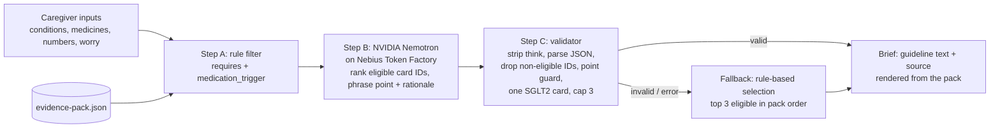

# Navigator by ConditionMap

A caregiver appointment-brief tool for people living with heart failure, type 2 diabetes, and chronic kidney disease (any combination). Caregivers answer three short steps and get up to 3 discussion points, each with a question to ask the clinician, the guideline text, and a DOI-linked source.

**Educational only. Not medical advice.** Submission for the Nebius x NVIDIA Global AI Hackathon (Best Apps and Agents track).

## Evidence-first pipeline



The model never supplies medical content. Guideline text, sources, labels, and the clinician question are always rendered from the evidence pack; the model's own question field is ignored.

Point guard (`checkPoint` in `src/lib/navigator.ts`): a model-written point is replaced with the card's first guideline sentence if it is empty, uses a relationship or first-person word, contains a number not in the card or the caregiver's inputs, names a medicine or class not in the card or the medicine list, or mentions "dose", "doses", or "dosing" when the card's guideline text does not mention a dose. Replaced points are marked as standardized. This is a lexical guard, not a semantic check.

## How Nemotron and Nebius Token Factory are used

- Server endpoint: `src/routes/api/public/navigator-brief.ts` (`POST /api/public/navigator-brief`), running server-side on Lovable Cloud hosting. The evidence pack is embedded at `src/server/evidence-pack.ts` (a test checks it matches `src/data/evidence-pack.json`).
- Model: NVIDIA Nemotron 3 Super, `nvidia/nemotron-3-super-120b-a12b`. Pin it with `NEBIUS_MODEL=nvidia/nemotron-3-super-120b-a12b`.
- Model selection: `NEBIUS_MODEL` if set; otherwise `GET /v1/models`, keep ids containing "nemotron", prefer "super", then "nano", then the first. Cached in memory. The model id the API reports and the latency are returned and shown in the UI.
- Request: base URL `https://api.tokenfactory.nebius.com/v1`, OpenAI-compatible `POST /chat/completions`, `temperature 0.2`, `max_tokens 2400`, 45 s timeout.
- JSON mode: `response_format: {"type": "json_object"}`. The prompt also requires one JSON object of the form `{"points":[{"card_id","point","rationale"}]}`.
- Reasoning off: for any Nemotron model the request sends `chat_template_kwargs: {"enable_thinking": false}`. The validator still strips any `<think>` block before parsing.
- Input: only the eligible cards (id, topic, guideline text) and the caregiver's inputs are sent. Inputs are length-capped server-side.
- Any HTTP error, timeout, or invalid output returns the rule-based fallback with an error code, and the UI labels it "Fallback: rule-based selection" with model "none (rule-based)".
- Health check: `POST {"health": true}` returns the selected model and the list of Nemotron model ids (never the key).

## Setup

Requires [Bun](https://bun.sh) (the lockfile is `bun.lock`).

```bash
bun install --frozen-lockfile
bun run dev            # local dev server
bunx vitest run        # pipeline and point-guard tests
bun run build          # production build
```

Environment (server-side only, never sent to the browser):

- `NEBIUS_API_KEY` (required for Nemotron): a Nebius Token Factory API key. On Lovable, add it under Project Settings → Secrets; locally, export it before `bun run dev`.
- `NEBIUS_MODEL` (optional): pin the model, for example `nvidia/nemotron-3-super-120b-a12b`.

Without a key the app shows the rule-based fallback with a visible notice. Check the connection with:

```bash
curl -s -X POST http://localhost:8080/api/public/navigator-brief -H 'content-type: application/json' -d '{"health":true}'
```

## Evidence sources

All 9 evidence cards are labeled Verified: taken directly from one of these published guidelines or consensus reports. The pack lives in `src/data/evidence-pack.json` (version 2026-10-27).

- ADA/KDIGO 2022. Diabetes Management in Chronic Kidney Disease: A Consensus Report by the ADA and KDIGO. de Boer IH, et al. Diabetes Care 2022;45(12):3075-3090. doi:[10.2337/dci22-0027](https://doi.org/10.2337/dci22-0027). Cards E1, E2, E4 to E8.
- ESC 2023. 2023 Focused Update of the 2021 ESC Guidelines for the diagnosis and treatment of acute and chronic heart failure. McDonagh TA, Metra M, et al. Eur J Heart Fail 2024;26(1):5-17. doi:[10.1002/ejhf.3024](https://doi.org/10.1002/ejhf.3024). Card E3.
- AHA/ACC/HFSA 2022. 2022 AHA/ACC/HFSA Guideline for the Management of Heart Failure. Heidenreich PA, Bozkurt B, et al. Circulation 2022;145(18):e895-e1032. doi:[10.1161/CIR.0000000000001063](https://doi.org/10.1161/CIR.0000000000001063). Card E9.

## Safety design

- Always-visible emergency banner (call 911).
- Deterministic eligibility filter and validator around the model; model output limited to card IDs and phrasing.
- Point guard rejects unsupported numbers, medicine names, dose or dosing language, and assumed relationships, and swaps in guideline text.
- Prompt forbids new drugs, doses, numbers, or start/stop/change advice; everything is framed as a question.
- Fallback to rule-based selection on any error, clearly labeled.
- No login, no storage, no analytics. Inputs live in the browser tab and are sent once to the model.

## License

MIT, copyright 2026 Saeb A. Ahsan. Built by Saeb Ahsan.
